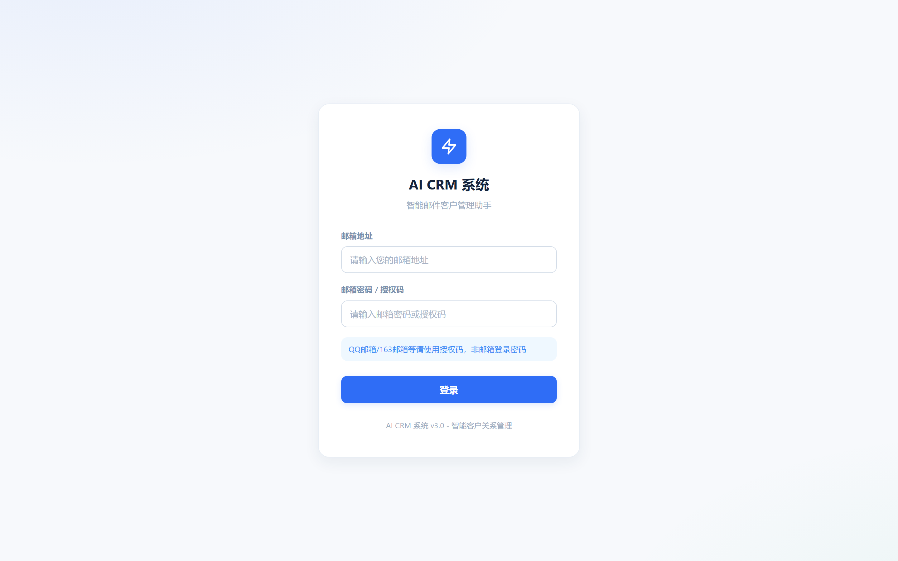

# AI CRM 系统 - 智能邮件客户管理助手

> 一款基于 AI 的业务员 CRM 系统，自动分析邮件、智能分类客户、生成回复草稿、跟进计划管理。让销售效率翻倍。

<p align="center">
  
  
</p>

---

## ✨ 功能特性

### 📧 智能邮件管理
- **多邮箱支持**：QQ邮箱、网易163/126、Gmail、Outlook 等主流邮箱
- **自动拉取**：IMAP 协议一键拉取邮件，自动去重
- **AI 智能分析**：DeepSeek AI 自动分析每封邮件的意图、优先级、摘要
- **优先级分类**：自动分为高优先级（需回复）、中优先级（需关注）、低优先级（无需处理）
- **手动调整**：支持手动修改邮件优先级，灵活可控
- **已读/已回复标记**：邮件状态一目了然

### 👥 客户关系管理
- **自动建档**：从邮件中自动识别并创建客户档案
- **客户画像**：AI 自动生成客户画像（客户类型、公司规模、沟通风格、风险机会）
- **优先级管理**：hot/warm/cold 三级客户优先级
- **等级管理**：A/B/C 三级客户等级
- **客户详情**：完整查看客户所有邮件往来、跟进记录、画像分析

### 🤖 AI 智能助手
- **全局 AI 助手**：内置 Agent，可直接操作系统（修改优先级、生成跟进、搜索客户等）
- **邮件专属 AI**：每封邮件下方内置 AI 助手，自动分析邮件并协助回复
- **多轮对话**：支持上下文对话，记住历史沟通
- **智能回复草稿**：根据邮件内容自动生成专业回复
- **中英双语**：支持中英文邮件回复，自动识别语言
- **快捷操作**：润色回复、翻译、摘要、提取关键信息、生成跟进等一键操作

### 📋 跟进计划
- **自动生成**：根据客户优先级和等级自动生成跟进计划
- **自定义规则**：可配置不同等级/优先级客户的跟进间隔
- **跟进提醒**：逾期跟进、今日待办自动提醒
- **完成标记**：一键标记跟进完成

### 💬 WhatsApp 聊天记录
- **批量导入**：支持粘贴或上传 WhatsApp 聊天记录
- **自动解析**：智能识别日期、发送人、消息内容
- **AI 分析对话**：情感倾向、对话意图、优先级、摘要自动生成

### 🔒 数据安全
- **本地部署**：所有数据存储在本地 SQLite 数据库，不上传第三方
- **多账号隔离**：每个邮箱账号数据独立，互不干扰
- **授权码加密**：邮箱授权码本地加密存储
- **无数据泄露**：AI 分析只发送邮件正文给 AI 服务商，不涉及本地数据库

---

## 🖼️ 产品截图

| 登录页 | 主面板 |
|--------|--------|
|  |  |

| 客户列表 | 邮件列表 |
|----------|----------|
|  |  |

---

## 🛠️ 技术栈

### 后端
- **框架**：FastAPI (Python 3.9+)
- **数据库**：SQLite（零配置，开箱即用）
- **ORM**：SQLAlchemy
- **AI 服务**：DeepSeek API (deepseek-v4-flash)
- **邮件协议**：IMAP4
- **认证**：Session + Token 混合模式

### 前端
- **架构**：原生 HTML + CSS + JavaScript（零构建，开箱即用）
- **样式**：自定义 CSS 设计系统
- **UI 交互**：原生 DOM 操作 + Fetch API
- **响应式**：适配桌面端

### 部署
- **服务器**：Uvicorn (ASGI)
- **打包**：单文件启动脚本，一键部署
- **跨平台**：支持 Windows / macOS / Linux

---

## 📦 快速开始

### 环境要求
- Python 3.9 或更高版本
- DeepSeek API Key（[免费申请](https://platform.deepseek.com/)）
- 一个开启 IMAP 服务的邮箱

### Windows 一键启动

```bash
# 1. 下载并解压项目
# 2. 双击 start.bat
# 3. 首次运行会提示编辑配置文件，填入 DeepSeek API Key
# 4. 自动安装依赖并启动服务
# 5. 浏览器自动打开 http://127.0.0.1:8000
```

### Linux / macOS

```bash
# 1. 进入项目目录
cd AI-CRM-System

# 2. 赋予执行权限
chmod +x start.sh

# 3. 运行启动脚本
./start.sh
```

### 手动启动

```bash
# 1. 进入后端目录
cd backend

# 2. 复制配置文件
cp .env.example .env
# 编辑 .env，填入 DEEPSEEK_API_KEY

# 3. 安装依赖
pip install -r requirements.txt

# 4. 启动服务
python app.py
```

然后浏览器访问 `http://127.0.0.1:8000`

---

## ⚙️ 配置说明

### 环境变量（`.env` 文件）

| 变量名 | 说明 | 默认值 | 必填 |
|--------|------|--------|------|
| `DEEPSEEK_API_KEY` | DeepSeek API 密钥 | - | ✅ |
| `AI_MAX_TOKENS` | AI 单次生成最大 Token 数 | 3000 | ❌ |
| `AI_MAX_HISTORY` | 对话历史保留条数 | 10 | ❌ |
| `CRM_ENC_KEY` | 数据加密密钥 | 自动生成 | ❌ |

> ⚠️ **重要**：`.env` 文件包含敏感信息，已在 `.gitignore` 中排除，不会被提交到代码仓库。

### 邮箱授权码获取

- **QQ邮箱**：设置 → 账户 → POP3/IMAP服务 → 生成授权码
- **网易163邮箱**：设置 → POP3/SMTP/IMAP → 开启IMAP → 新增授权码
- **Gmail**：Google 账户 → 安全性 → 应用专用密码

---

## 📁 项目结构

```
AI-CRM-System/
├── backend/                 # 后端代码
│   ├── app.py              # 主应用入口，API 路由
│   ├── ai_deepseek.py      # AI 核心逻辑（提示词、对话、分析）
│   ├── ai_agent.py         # AI Agent 动作执行
│   ├── auth.py             # 认证与加密
│   ├── models.py           # 数据库模型
│   ├── email_fetcher.py    # 邮件拉取与处理
│   ├── email_providers.py  # 邮箱服务商配置
│   ├── requirements.txt    # Python 依赖
│   ├── .env.example        # 配置文件模板
│   └── __init__.py
├── frontend/               # 前端代码
│   ├── index.html          # 主页面
│   ├── login.html          # 登录页
│   ├── customer_detail.html # 客户详情页
│   ├── email_detail.html   # 邮件详情页
│   ├── css/
│   │   └── style.css       # 样式文件
│   ├── js/
│   │   └── common.js       # 通用工具函数
│   ├── images/
│   │   └── login-bg.png    # 登录页背景
│   └── logo.png            # Logo
├── docs/                   # 文档
│   ├── screenshots/        # 产品截图
│   ├── deployment.md       # 部署指南
│   ├── roadmap.md          # 开发路线图
│   └── api.md              # API 文档
├── start.bat               # Windows 启动脚本
├── start.sh                # Linux/macOS 启动脚本
├── README.md               # 项目说明
├── 启动说明.md             # 中文启动说明
└── .gitignore              # Git 忽略配置
```

---

## 🧪 测试

### 功能测试清单

- [x] 用户登录/登出
- [x] 多账号切换
- [x] 邮件拉取与去重
- [x] AI 邮件分析（意图/优先级/摘要/回复草稿）
- [x] 手动修改邮件优先级
- [x] 客户自动建档
- [x] 客户画像生成
- [x] 客户优先级/等级管理
- [x] AI 助手对话
- [x] AI Agent 动作执行（修改优先级、生成跟进等）
- [x] 邮件专属 AI 助手
- [x] 跟进计划生成与管理
- [x] WhatsApp 聊天记录导入与分析
- [x] 数据清空

### 安全测试

- [x] 敏感文件（.env、数据库）Git 排除
- [x] 邮箱授权码加密存储
- [x] 多账号数据隔离
- [x] API 端点认证保护

---

## 🗺️ 开发路线图

### ✅ v3.0 - 当前版本（已完成）
- 邮件管理与 AI 自动分析
- 客户关系管理与画像生成
- AI 智能助手（Agent 模式）
- 跟进计划管理
- WhatsApp 聊天记录导入分析
- 多账号支持
- 一键启动脚本

### 🚀 v3.1 - 规划中
- [ ] 邮件发送功能（SMTP）
- [ ] 客户标签与分组
- [ ] 数据导出（Excel/CSV）
- [ ] 批量操作
- [ ] 深色模式

### 🔮 v4.0 - 未来规划
- [ ] 多用户协作
- [ ] 工作流自动化
- [ ] 数据分析仪表盘
- [ ] 移动端适配
- [ ] 插件系统

---

## 🤝 贡献

欢迎提交 Issue 和 Pull Request！

1. Fork 本仓库
2. 创建特性分支
3. 提交更改
4. 发起 Pull Request

---

## 📄 许可证

MIT License

---

## ⚠️ 免责声明

- 本项目仅用于学习和内部使用
- 使用前请确保遵守所在地区的数据保护法规
- AI 分析结果仅供参考，重要决策请人工核实
- 请勿用于非法用途

---

<p align="center">
  <strong>如果这个项目对你有帮助，别忘了给个 ⭐ Star</strong>
</p>
